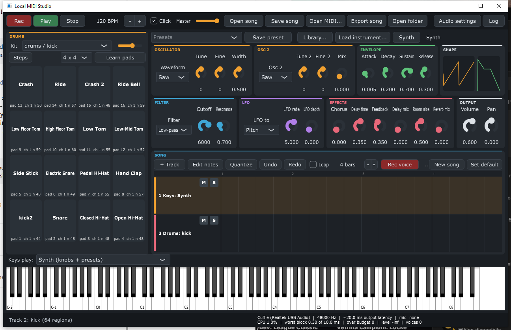

<div align="center">
  

An offline synthesizer, sampler and multitrack recorder with audio editing, for Windows.<br>
Plug in any USB-MIDI keyboard, put on headphones and play: no accounts, no cloud, no network.


---



</div>

## 🌃 Features

- 🎹 **Plug and play MIDI**: keyboards are detected and enabled on hot-plug; notes, velocity, pitch bend, mod wheel and sustain pedal.
- 🔊 **32-voice synth**: band-limited saw / square / pulse / triangle, sine, noise, a second detunable oscillator; ADSR, resonant LP/HP/BP filter, LFO (vibrato, wah, tremolo, PWM).
- 🎻 **Sampler**: opens `.sfz` libraries and single audio files; a built-in library menu downloads free CC0 instruments.
- 🥁 **Drum pads and step sequencer**: 16 on-screen pads that learn your hardware pads, and a 16-step grid to build beats.
- 🎚️ **Mixer and effects**: per-track volume, pan, chorus, delay and reverb, a master volume; presets and MIDI Learn on every knob.
- 🎼 **Song mode**: up to 8 tracks, count-in and metronome, loop recording with overdub, piano roll with quantize, 50-level undo/redo, mute/solo, save/open songs.
- 🎤 **Voice and audio files**: record your microphone into a track, or drag WAV/MP3/FLAC/Ogg files onto the timeline; move, trim, split and duplicate them, zoomed in with Ctrl+wheel.
- 📂 **MIDI files**: open any `.mid` (channel 10 → drums), export the mix to 24-bit WAV.
- 🎓 **Genre sketches**: a script writes house, hip hop, rock, bossa nova and reggae loops on separate tracks, to hear how each genre is built.
- ⚡ **Real-time safe**: lock-free MIDI path, no allocation in the audio callback, a 30-minute stress test.
- ✋ No telemetry, no accounts, no internet needed.
- 📖 Open source (GPL-3.0).

### ⬇️ Download

Grab `LocalMIDIStudio-<version>-win64.exe` from the [Releases](../../releases/latest) page (Windows 10/11, 64-bit), or build it from source (below). It is a single file that needs only Windows system DLLs: copy it anywhere and run it. The latest release may be older than this page: build from source for everything described here.

## 🚀 Getting started

1. Plug the keyboard in by USB, before or after launching.
2. **Audio settings** (top right) → **Output**: pick your headphones, press **Test** to hear a tone.
3. Play. No keyboard? Click the on-screen piano or use the computer keys `A W S E D F T G Y H U J K` (middle C = A).

<details>
<summary><h3 style="display: inline;">🎛️ Sounds, knobs and drums [click to expand]</h3></summary>
<hr/>

- **Presets** (top): 9 built-in sounds; **Save preset** stores the current sound as `Documents\LocalMIDIStudio\Presets\<name>.json`, listed under *Yours*.
- **Knob groups**: Oscillator (with *Tune* in semitones and *Fine* in cents), Osc 2 (a second waveform, tuned against the first; *Mix* blends it in), Envelope, Shape (what the sound looks like), Filter, LFO, Effects, Output. *LFO to* picks the target (Pitch = vibrato, Filter = wah, Volume = tremolo, Width = PWM on the *Pulse* wave); the **mod wheel** adds to *LFO depth*.
- **MIDI Learn**: right-click any knob → *MIDI Learn*, then turn a knob or fader on the keyboard (saved in `%APPDATA%\LocalMIDIStudio\midi-map.json`). The sustain pedal (CC64) is never learned.
- **Library...**: every installed `.sfz` in the library folder, plus free CC0 downloads (guitars, saxophones, cello, strings, tuba, double bass). *Choose library folder...* changes where they go.
- **Load instrument...** opens an `.sfz` or an audio file (WAV/FLAC/OGG/AIFF, played from C4); **Synth** switches back.
- **Drums** (left column): pick the kit and its volume. **Learn pads**: hit the pad lit in blue on screen, 16 in order, so the screen matches your hardware; right-click a pad to choose its sound. Give your pads their own MIDI channel (e.g. 10) if they share notes with the keys.
- **Keys play:** (above the keyboard) picks the instrument of the selected track.
</details>

<details>
<summary><h3 style="display: inline;">🎼 Song mode and MIDI files [click to expand]</h3></summary>
<hr/>

- **Tracks**: track 1 = Keys, track 2 = Drums; **+ Track** adds more (up to 8). Click a track to select it: keys, knobs, presets and *Keys play* act on it. Right-click a track's name to delete it (tracks 3 and up) or clear it. **M** / **S** = mute / solo.
- **Rec** records the selected track after a one-bar count-in while the others play; **Stop** keeps the take. **Play** plays the song. **Space bar** = Play / Stop (also stops a recording).
- **Loop**: tick it, pick the bars, press Rec: the bars repeat and every pass you play is added on top of the previous ones (you hear them while you play). Stop keeps it all in the track.
- **Edit notes**: piano roll of the selected track: click to add, drag to move or stretch, right-click to delete. **Quantize** snaps it to 1/16, **Undo** / **Redo** go back and forth through the last 50 changes (takes too).
- **Steps** (DRUMS panel): a 16-step grid, one row per pad sound; click squares to build a one-bar beat, set how many bars it repeats, press Play.
- **Mixing**: *Volume* and *Pan* (Output knobs) belong to the selected track; *Master* (top bar) sets the level of all tracks, the exported song included. All three are saved in the song.
- **Save song** / **Open song**: `.lmsong` files in `Documents\LocalMIDIStudio\Songs` (tempo, click, every track's sound, instrument, mute/solo, notes and audio). Every take is also saved to `Songs\autosave.lmsong`.
- **Export song** writes the audible tracks to a 48 kHz / 24-bit WAV (metronome not included).
- **Open MIDI...**: channel 10 → Drums, every other file track → its own track, file tempo → BPM.
- **Genre sketches**: `python tools/genres.py` writes 8-bar loops to `Documents\LocalMIDIStudio\Genres`. Open one, give each track a sound, Play, then mute/solo to hear each ingredient. The patterns are plain text at the top of the script.
</details>

<details>
<summary><h3 style="display: inline;">🎤 Voice and audio files [click to expand]</h3></summary>
<hr/>

- **Rec voice** (red button in the SONG panel): select a track, press it and sing after the count-in; press it again (or Stop) to finish. The first time it opens *Audio settings*: pick your microphone under *Input* (the status bar then shows `mic: ...`).
- **Audio files**: drag WAV, MP3, FLAC, Ogg or AIFF files from Explorer onto a track; each plays from where you drop it (below the last track: a new track). A track holds several files.
- **Editing**: drag a region to move it (Shift: snap to 1/16), drag its edges to cut the start or the end. Right-click a region: *Split here*, *Duplicate* (Ctrl+D), *Delete* (Del), *Untrim*. Cuts get a 5 ms fade, so they don't click.
- **Zoom**: Ctrl+wheel over the SONG panel zooms around the mouse, the wheel scrolls in time, double-click on empty space shows the whole song. The ruler numbers the bars.
- Voices and files go through the track's Volume, Pan and effects, and are in Export song. *Save song* keeps them as WAVs in the `Audio` folder next to the song; every voice take is also kept in `Songs\Audio\voice-<date>.wav`.
- Audio edits are not in Undo (the original files stay on disk). Up to 32 regions and 30 minutes of audio per track.
</details>

<details>
<summary><h3 style="display: inline;">🩺 Latency and troubleshooting [click to expand]</h3></summary>
<hr/>

With *Windows Audio* (shared WASAPI) expect ~20 ms. For less: **Audio settings** → *Windows Audio (Exclusive Mode)* or *(Low Latency Mode)*, buffer 128–256 samples. ASIO is not compiled in (it needs the Steinberg ASIO SDK).

| Symptom | Fix |
|---|---|
| Keyboard not in "Active MIDI inputs" | Replug USB; close other apps holding the port (DAWs, browser MIDI pages): Windows MIDI ports are exclusive. |
| Keyboard ticked, but keys do nothing | Windows put the USB port to sleep: Power Options → Advanced → USB settings → USB selective suspend → Disabled, then reboot. |
| Notes arrive, no sound | Wrong output, Volume at 0 or Cutoff very low. Press **Test**. |
| Crackles | Raise the buffer size; watch "underruns" in the status bar. |
</details>

<details>
<summary><h3 style="display: inline;">🕳️ Building from source [click to expand]</h3></summary>
<hr/>

Needs CMake ≥ 3.22, Ninja and MinGW-w64 GCC (tested with GCC 16.1). JUCE 7.0.12 is a git submodule (JUCE 8 refuses MinGW; with MSVC you can switch to JUCE 8).

```bash
git clone --recursive https://github.com/HP-Ozy/local-midi-studio.git
cd local-midi-studio
cmake -S . -B build -G Ninja -DCMAKE_BUILD_TYPE=Release
cmake --build build
ctest --test-dir build --output-on-failure
```

The app lands in `build/LocalMIDIStudio_artefacts/Release/`. `tests/RenderTest.cpp` renders the real engine offline (notes, velocity, sustain, polyphony, voice stealing, clipping, tuning, determinism, CPU time), no hardware needed:

- `RenderTest <folder>` writes listening references (see `docs/measurements/p1-refs`)
- `RenderTest --stress 30` runs a silent 30-minute real-time stress test on the default audio device
- `RenderTest --probe <file.sfz|file.mid>` checks that a library loads and plays, or lists the parts of a MIDI file

Engineering rules for changes to the audio engine are in [docs/ENGINEERING.md](docs/ENGINEERING.md).
</details>

## 🎹 Sample libraries

Recommended free sets: **Salamander Grand Piano V3** (CC BY 3.0) and **Salamander Drumkit** (CC BY-SA 3.0) by Alexander Holm. Load their `.sfz` with *Load instrument...* or put them in the library folder. Credit the author if you publish music made with them.

## 📜 License

Local MIDI Studio is free software under the [GNU General Public License v3.0](LICENSE). It is built on [JUCE](https://juce.com), used under its GPLv3 option.
